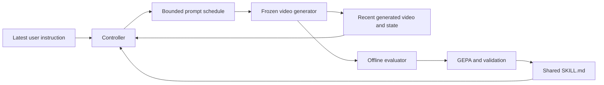

# 流式视频共享 Harness 演化计划

状态：研究计划。第一版采用 LongLive 作为视频生成底模，通过 Hermit 和 GEPA 离线演化一份共享的 `SKILL.md`。

## 研究目标

用户可以在视频生成过程中修改指令。控制器根据已经生成的画面，将最新用户要求编译成短期过渡计划，
在有限响应时间内完成自然的动作和场景转换，同时保持未被要求改变的属性。

核心假设是：在视频模型、控制器模型和推理预算相同的条件下，从多个任务的执行反馈中演化出的共享 skill，
能够改善未见指令流的过渡质量。每次交互产生的过渡 prompt 是控制器的输出；跨任务保留和优化的是控制策略。
初版研究连续镜头中的动作、交互、环境变化和可达的场景迁移，分别报告不同任务类别的表现。

## 冻结组件和演化范围

| 组件 | 第一版处理方式 |
|---|---|
| 视频生成底模 | 固定 checkpoint、精度、分辨率、采样器、生成 chunk 大小和缓存更新机制 |
| 在线控制器模型 | 固定权重、输入格式、解码设置、视觉输入和调用预算 |
| GEPA 使用的学习模型 | 固定模型和调用设置，允许其提出文本修改 |
| 评估器 | 固定 VLM、检查清单、抽帧方式、解码设置和聚合规则 |
| 可演化文件 | 仅 `skills/transition/SKILL.md` |
| 执行代码和适配器清单 | 固定 `pipeline.py`、`controller.py`、`judge.py`、`adapter.yaml` 等 |
| 单条视频的运行状态 | 独立维护，记录当前实体、动作、已执行计划和最新指令 |

Skill 描述如何观察状态、区分应改变和应保留的内容、识别动作前提、分配过渡时间，以及处理执行偏差。
控制器必须实际读取候选版本的 skill；将文件列为 `learnable` 本身不会改变代理行为。
初版不同时演化工具代码或跨任务记忆，以便判断策略文本的贡献。

适配器结构和导出约束遵循 [adapter.yaml 规范](../framework/adapter-manifest.md)。
`ADAPTER.md` 保留固定入口说明，控制器显式读取 `skills/transition/SKILL.md`。

## 在线执行和离线演化



在线控制器接收近期画面、已到达的新旧指令、计划执行进度和过渡预算，输出若干过渡 prompt 及持续 chunk 数。
先在可控性试验中确定底模能执行的最短阶段长度，再确定计划长度和总预算。每个阶段的时长为正整数，
计划执行后回到最新用户目标。用户在过渡中再次改口时，取消未执行部分，从最新实际画面重新规划。

控制器只能访问当前及过去的指令。即使离线任务文件包含完整指令流，调度器也只在事件到达时向控制器公开内容。
已经展示的帧保持不变。记录用户指令到达、规划返回、条件实际生效以及响应可见的时间，区分视频时间和墙钟时间。

离线演化以一条完整交互视频为一个任务。多条任务共用候选 skill，评估后由 GEPA 提出修改并在验证集上选择版本。
完整评估不阻塞线上生成；部署时使用已验证的 skill 版本，并保留每条视频所用版本的标识。

## 数据和交互协议

先准备四条短视频指令流验证执行和评分。随后构建 MVP 数据，建议初始规模为 30 条训练流、10 条验证流、
20 条测试流，每条 40 至 60 秒，包含 3 至 5 次切换。规模根据试跑测得的生成和评估成本调整。

任务覆盖动作变化、持物操作、实体进入、天气变化和可达场景迁移。按事件模板、场景和实体组合划分数据；
同一任务的改写或不同 seed 留在同一划分。训练集用于提出修改，验证集用于选择，测试集在方案冻结后使用。
可获得的公开 benchmark 保留为额外外部测试，记录数据版本和使用范围。

| 测试协议 | 处理方式 |
|---|---|
| 标准连续事件切换 | 初版使用至少 10 秒的指令间隔，保留完整评分窗口 |
| 场景迁移 | 预先定义允许改变和需要保留的属性，校准场景相关判据，单独报告 |
| 过渡中再次改口 | 评估器读取指令时间线，处理旧目标被取消的情况，作为扩展协议报告 |
| 多次切换的长视频 | 比较早期与后期切换，检查身份、画质和响应能力是否退化 |

论文部分指标使用切换后最多 5 秒的观察窗口。高频改口时，后续指令可能进入同一窗口；扩展协议需要在下一次指令处
截断旧目标完成考核，或使用完整事件时间线判断当时有效的目标。该选择必须在演化前固定，扩展分数与原协议分开报告。

## 评估器

以 SEGUE 的过渡指标为起点：VBS、MBS、OSE、NSE、SP、ScP、SUF、TP。论文的采样、清单和聚合定义见
[附录 A.7.3 和 A.10](https://arxiv.org/html/2609.38691v2)。先核对官方实现和权重是否可获取；自行复现时记录差异。
对于场景迁移和高频交互，分别锁定适用的扩展协议。

评估输入为视频、原始新旧用户指令和切换时间。各方法生成的中间 prompt 作为执行记录保存，用户目标保持独立。
初版选择分数采用适用过渡指标的均值，同时保留每项结果和适用标记；无主体样本的 SP 标记为不适用，避免当作零分。
预先固定适用性和缺失值的聚合规则，防止不同候选改变评分口径。

| Hermit 接口 | 内容 |
|---|---|
| `RunOutput.output` | 视频及事件记录的路径 |
| `RunOutput.log` | 控制器轨迹、计划、执行状态和运行日志 |
| `RunOutput.extra` | Skill 标识、checkpoint、seed、推理配置、计时和已知使用量 |
| `JudgeResult.score` | 用于候选比较的连续分数 |
| `JudgeResult.feedback` | 带时间位置的失败条目及可复查的观察 |
| `JudgeResult.extra` | 分项分数、二元判定、适用标记、抽帧路径和评估版本 |

反馈优先来自未通过的检查条目及对应画面，例如“新动作开始前缺少可见的放置物品过程”，而非仅返回总分。
额外记录用户目标达成、响应延迟和生成成本。选择候选时使用的达成与延迟约束，在校准阶段确定并冻结。
解析失败、模型调用失败和视频质量低分分别记录，按预先确定的错误处理策略执行。

校准集包含正常过渡、突然跳变、画面静止但不响应新要求、身份改变等案例，由人工逐次切换检查。
自动评分与人类判断存在明显偏差时，先调整和冻结评估协议，再启动演化。

## 实施阶段

| 阶段 | 工作和交付 | 验收条件 |
|---|---|---|
| 1 固定协议 | 确定模型、可演化路径、接口、任务范围和记录格式 | 各组件版本、数据划分规则和预算可追溯 |
| 2 校准评估器 | 实现抽帧、VLM 判定、聚合和逐项反馈 | 分数能追溯到检查项及画面，校准案例可人工复查 |
| 3 打通控制器 | 实现 skill 加载、状态观察、计划输出、执行和改口处理 | 四条短指令流完整运行，确认 skill 生效且底模能执行过渡条件 |
| 4 建立数据和基线 | 固定任务划分，生成各项对照视频 | 比较方法使用相同起始条件、配对 seed 和规定预算 |
| 5 演化共享 skill | 安装 GEPA 依赖，接入 pipeline 和 judge，运行小预算迭代 | 完成生成、评分、修改、验证和版本选择，记录所有候选 |
| 6 独立检验 | 冻结选定 skill，在测试集、多 seed 和压力场景上评估 | 自动指标、指令达成、延迟、人工偏好和失败案例一起报告 |

阶段 3 是扩大生成预算的前提。若固定底模无法执行计划中的短期条件变化，先调整可控性协议，
再确定适合演化的策略空间。后续加入第二个视频底模时，单独检验 skill 直接迁移和重新演化的效果。

## 对照实验

| 方法 | 要回答的问题 |
|---|---|
| 原始 prompt 直接切换 | 底模自身的切换能力和成本是多少 |
| 固定 LLM 润色最新 prompt | 普通 prompt polish 带来多少改善 |
| 读取画面的手写 skill | 状态感知和人工策略带来多少改善 |
| 同一底模上的 SEGUE 式固定规划策略 | 能否超过已有的强规划策略 |
| 演化后的共享 skill | 在相同控制器与执行条件下，演化额外贡献多少 |

手写、SEGUE 式和演化策略使用相同控制器模型、视觉输入、调用预算、底模和采样配置。
对直接切换等成本较低的方法，保留其真实成本和延迟。SEGUE 式规划器的实现来源及与原方法的差异需要说明；
完整 SEGUE 包含底模训练，使用不同权重的结果另列。

优先检验演化版本相对初始手写版本和固定规划策略的改善。后续消融可移除视觉状态、将逐项反馈改为仅提供总分，
或在相同候选预算下随机改写 skill，以区分不同信息和搜索过程的贡献。

## 演化配置和预算

采用 [GEPA 集成](../methods/gepa.md)，将 `files` 显式设为 `skills/transition/SKILL.md`。
候选 skill 在不同任务间共享，每条视频的运行状态独立。验证时使用固定任务和 seed 集，保留初始版本、
所有候选、修改差异、分项验证结果和最终选择依据。

先通过四条短流测量生成 GPU 时间、评估 VLM 调用、控制器和学习模型使用量，再固定首轮候选数、总生成量和资源预算。
缓存按任务、skill 内容、seed、模型 checkpoint、采样设置和评估器版本区分；比较保留版本时使用一致协议。
具体接入遵循 [任务集成](../tutorials/your-own-task.md)和 [pipeline 与 judge 接口](../framework/task.md)。

## 统计和最终验收

最终测试建议使用至少三个生成 seed，按完整指令流做配对统计并报告置信区间，保留同一视频内多次切换的相关性。
人工比较隐藏方法名称和自动分数，并随机化左右位置。记录评价者看到的窗口、问题和分歧处理规则。

验收同时检查：未见任务上的过渡质量、原始用户目标达成、响应延迟、长期稳定性和人工偏好。
若自动分数改善而人工评价没有对应改善，检查评估器偏差和过拟合，结果保留这种差异。
报告所有比较方法的资源成本、错误率、分项指标和代表性失败案例。

## 交付结构

计划中的实现按仓库现有任务集成布局组织：

```text
examples/video_transition/
├── README.md
├── utils/
│   ├── controller.py
│   ├── pipeline.py
│   ├── judge.py
│   ├── evaluator/
│   ├── task-info/README.md
│   ├── tasks.jsonl
│   └── splits/
│       ├── train.txt
│       ├── val.txt
│       └── test.txt
└── gepa/
    ├── run.yaml
    └── adapter/
        ├── adapter.yaml
        ├── ADAPTER.md
        ├── EVOLVER.md
        └── skills/transition/SKILL.md
```

训练输出保存初始与最终 skill、候选历史、配置与版本、对照视频、逐项评估、时间与资源记录、人工评价和失败案例。
第一项实现里程碑是四条指令流的可复查闭环；通过后扩展数据规模和演化预算。

## 运行前准备

运行环境需要 Hermit 的 Python 依赖、`requirements-gepa.txt`、选定视频底模及其独立运行环境、
固定评估 VLM、控制器和学习模型服务，以及用于校准和最终盲评的视频查看工具。
使用实际可用硬件测量运行成本。模型服务、数据和密钥按具体环境配置，密钥通过环境变量提供。

## 参考资料

- [SEGUE 与 OpenTrans 360](https://arxiv.org/abs/2609.38691)：过渡规划、评估协议及完整模型训练方案。
- [LongLive](https://arxiv.org/abs/2509.22622)：首个视频生成底模的原始工作。
- [Hermit 自定义适配器](../tutorials/customize-an-adapter.md)：可演化文件和固定文件的声明。
- [Hermit GEPA](../methods/gepa.md)：反思更新、候选选择及验证数据要求。
